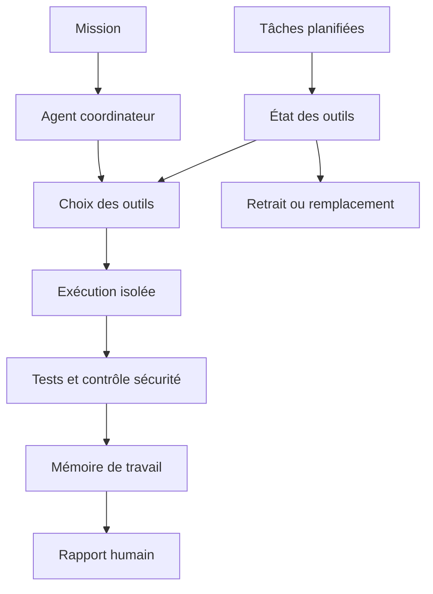

# MoltBot Hub

Un atelier d’agents qui ne se contente pas de lancer des tâches : il vérifie régulièrement que ses outils sont encore disponibles, sûrs et adaptés au travail demandé.

Ce dépôt est une vitrine publique reconstruite sans historique privé. Le code, les configurations, la mémoire et les canaux du système exploité ne sont pas publiés.

## Ambition

Faire vivre des agents dans la durée exige quatre disciplines :

- leur donner uniquement les outils nécessaires à la mission ;
- contrôler ces outils avant et après usage ;
- planifier les vérifications récurrentes ;
- remettre les décisions sensibles à un humain.

## Le cycle recherché

| Moment | Question posée |
|---|---|
| Avant la mission | Quels outils et quelles données sont réellement nécessaires ? |
| Pendant | L’agent reste-t-il dans son périmètre et produit-il des preuves ? |
| Après | Les tests, la sécurité et la documentation passent-ils encore ? |
| Chaque nuit | Un outil a-t-il dérivé, échoué ou trouvé un meilleur remplaçant ? |
| Chaque semaine | Que faut-il promouvoir, corriger ou retirer ? |

## Ce que cette vitrine ne publie pas

- mémoire, conversations ou données utilisateur ;
- tâches planifiées réelles et canaux de notification ;
- clés, modèles de configuration et règles d’accès ;
- code d’exploitation ou procédure de connexion ;
- inventaire des machines et services.

## Trajectoire

1. Mesurer la qualité et le coût de chaque route modèle.
2. Tester les outils nouveaux dans un bac à sable reproductible.
3. Détecter les régressions avant qu’un agent en dépende.
4. Rendre chaque décision d’autonomie lisible et révocable.

Voir aussi [Infrastructure](https://github.com/TimoLeDozo/Infrastructure), la couche qui mesure et protège les ressources sous le Hub.

## Auteur

Timothé Cagin, ingénieur diplômé ICAM  
[ICARUS](https://icarus-ia.fr) · [LinkedIn](https://www.linkedin.com/in/timoth%C3%A9-cagin-61a711225/)
