# MoltBot Hub

**Tirer 100 % de ce que mes modèles savent faire, et donner à mes agents des outils qu'ils peuvent réellement utiliser.**

Ce dépôt est une **vitrine**. Il expose l'architecture de décision et les garde-fous, pas l'installation. Aucune clé, aucun point d'accès, aucune adresse, aucune configuration exécutable. Le dépôt exploité reste privé.

---

## Le problème que je traite

« Utiliser 100 % de la puissance d'un modèle » n'est pas une phrase mesurable. Ce qui l'est :

- **Est-ce que la bonne tâche va au bon modèle ?** Un modèle de 7 milliards de paramètres sur une tâche que 3 milliards traitent mieux, c'est de la mémoire GPU gaspillée. Et ça arrive.
- **Est-ce qu'un échec est rattrapé ou subi ?** Une clé qui plafonne, un fournisseur qui tombe : sans échelle de repli, le travail s'arrête.
- **Est-ce qu'un agent dispose des bons outils ?** Sans outillage, il réécrit ce qui existe. Avec trop d'outillage, il ne trouve plus rien.
- **Est-ce que quelqu'un compte ?** Sans journal, aucune de ces questions n'a de réponse.

---

## Plusieurs moteurs, un rôle chacun

Aucun modèle ne fait tout. Chaque moteur a un rôle écrit, et le travail circule entre eux par des passages de relais tracés.

```mermaid
flowchart TB
    T["Tim : intention, décisions,<br/>gestes irréversibles"]
    P["Pilote<br/>planifie, découpe, vérifie"]
    J["Juge<br/>critique les réponses,<br/>relit les sessions"]
    E["Exécutant<br/>code en arbre jetable"]
    O["Second avis<br/>autre fournisseur"]
    L["Modèles locaux<br/>tâches de nuit, données privées"]
    M["Agent de messagerie<br/>alertes et questions courtes"]

    T --> P
    P -->|brief écrit| E
    P -->|question ouverte| O
    P -->|lot de nuit| L
    E -->|résultat et preuves| J
    O --> J
    L --> J
    J -->|verdict| P
    P -->|décision à prendre| M --> T

    style T fill:#1a2b26,stroke:#6d9083
    style J fill:#2d2416,stroke:#b7986a
```

Deux règles tiennent l'ensemble :

1. **Celui qui écrit n'est pas celui qui juge.** Un modèle relit mal son propre travail.
2. **Un relais est un fichier, pas une conversation.** Le brief et le résultat restent lisibles après coup, par un humain ou par un autre moteur.

---

## L'échelle économique

Tout appel passe par un point unique. C'est ce qui rend la mesure possible.

```mermaid
flowchart TB
    A["Tâche"] --> R{"Routeur<br/>point de passage unique"}

    R -->|1| L["Modèle local<br/>GPU de la station, 0 €"]
    L -->|indisponible ou plafonné| C1["Palier cloud rapide"]
    C1 -->|échec mesuré| C2["Second fournisseur"]
    C2 -->|échec mesuré| C3["Palier explicite<br/>demandé par l'appelant"]

    L & C1 & C2 & C3 --> J["Journal : latence,<br/>coût, échecs, quotas"]
    J --> M["Mesure et arbitrage"]
    M -.réévalue.-> R

    style L fill:#1a2b26,stroke:#6d9083
    style J fill:#2d2416,stroke:#b7986a
```

**On descend l'échelle sur un échec mesuré, jamais par précaution.** Le local d'abord : il coûte zéro et les données ne sortent pas.

> Incident derrière cette règle : six scripts planifiés parlaient à un fournisseur en direct, hors du routeur. Chacun réinventait son repli, aucun n'était compté. Le journal, seul endroit où mesurer, ne les voyait pas. Le routeur est devenu le **seul chemin autorisé**.

---

## Un titulaire par capacité

Un modèle n'est pas titulaire d'une tâche parce qu'il est récent ou gros. Il l'est **parce qu'il a gagné au banc**.

```mermaid
flowchart LR
    T["Tâche réelle<br/>tirée de l'usage"] --> B["Banc d'essai"]
    B --> TIT["Titulaire actuel"]
    B --> CHA["Challenger"]
    TIT & CHA --> S["Score sur la tâche"]
    S --> D{"Le challenger<br/>gagne ?"}
    D -->|oui| REMP["Il REMPLACE"]
    D -->|non| GARDE["Le titulaire reste"]

    style REMP fill:#1a2b26,stroke:#6d9083
```

**Un challenger remplace, il ne s'ajoute pas.** Deux modèles résidents pour une même capacité, c'est de la mémoire immobilisée et une décision qu'on n'a pas prise.

Une mesure qui illustre l'intérêt de la méthode : sur une tâche de doctrine interne, le **modèle 3B a battu le 7B**. L'intuition disait l'inverse.

La vérité matérielle est figée dans un fichier de capacités (mémoire, présence d'un GPU). L'état réel des modèles est obtenu **en interrogeant le moteur**, jamais en croyant un fichier de configuration.

---

## Donner les bons outils aux agents

Un agent utile est un agent **outillé et borné**.

```mermaid
flowchart TB
    subgraph Agent["Agent"]
        BUT["Objectif"]
    end

    subgraph Outillage["Ce qu'il peut appeler"]
        IDX["Index d'outils<br/>un besoin en clair, des réponses classées"]
        MCP["Serveurs MCP<br/>plafond figé"]
        SK["Compétences<br/>plafond, note sur 20 par usage réel"]
    end

    subgraph Gardes["Ce qui l'encadre"]
        SENT["Sentinelle d'injection<br/>sur tout contenu externe"]
        MEM["Mémoire partagée<br/>entre agents"]
        DLQ["File d'échecs<br/>avec propriétaire"]
        HUM["Porte humaine sur<br/>l'irréversible"]
    end

    BUT --> IDX --> MCP & SK
    MCP & SK --> SENT
    SENT --> MEM
    SENT -->|hostile| DLQ
    MEM --> HUM

    style SENT fill:#2b1a1a,stroke:#a05a5a
    style HUM fill:#1a2b26,stroke:#6d9083
```

Le contexte chargé est **la ressource rare**. D'où deux plafonds explicites : un nombre maximum de compétences actives, un nombre maximum de serveurs d'outils. La revue se fait sur l'usage réel, pas sur l'envie. Une compétence jamais invoquée en trente jours redescend, une compétence demandée deux fois remonte. Chaque serveur d'outils supplémentaire est du contexte consommé **et** une surface d'attaque.

---

## Des décisions qui n'attendent pas indéfiniment

Une question posée à un humain qui ne répond pas bloque tout. Chaque décision porte donc une recommandation, une échéance et un défaut réversible.

```mermaid
flowchart LR
    Q["Question d'un agent"] --> D["Décision :<br/>options, recommandation,<br/>échéance, réversible ?"]
    D -->|Tim tranche| A["Appliquée avec reçu"]
    D -->|échéance passée<br/>et réversible| DEF["Défaut appliqué"]
    D -->|échéance passée<br/>et irréversible| ATT["Reste en attente"]
    A & DEF --> J["Journal des décisions"]
    J -.relu chaque semaine.-> D

    style A fill:#1a2b26,stroke:#6d9083
    style ATT fill:#2d2416,stroke:#b7986a
```

Plus de 340 décisions tracées depuis l'été. Aucun défaut ne s'applique à un geste qu'on ne rattrape pas.

---

## Ce qui est mesuré plutôt que promis

| Question | Comment j'y réponds |
|---|---|
| Le bon modèle est-il titulaire ? | Banc d'essai sur tâches réelles, sortie en échec si un challenger gagne |
| La recherche documentaire tient-elle ? | Test de non-régression, seuils de rappel et de précision obligatoires avant fusion |
| Le routeur d'outils classe-t-il bien ? | Requêtes étalons rejouées, rang attendu vérifié |
| Un job a-t-il vraiment tourné ? | Registre durable, distinct du code de retour |
| Les réponses des agents s'améliorent-elles ? | Relecture critique des sessions 4 fois par semaine, rapport daté |
| Le budget tient-il ? | Journal par appel, plafonds par palier, compteur d'usage |

---

## Sécurité

### Le contenu externe est hostile jusqu'à preuve du contraire

Page web, courriel, message, document joint : tout passe par une sentinelle avant d'atteindre un modèle.

- **Échec en position fermée.** Une sentinelle inexécutable vaut quarantaine, pas laissez-passer.
- **Cloisonnement de l'invite.** Le contenu tiers est enfermé entre marqueurs, et ces marqueurs sont neutralisés à l'intérieur du contenu. Sans cette neutralisation, écrire le marqueur de fermeture suffit à s'évader et à faire lire la suite comme une consigne. C'est l'évasion la plus simple qui soit, et elle ne coûte rien à fermer.
- **Le modèle n'est jamais l'autorité finale** sur une action irréversible.

### La porte humaine

Toute action qu'on ne rattrape pas (un courriel envoyé, un déploiement, un ordre financier) s'arrête sur une décision humaine. La chaîne est figée : *ingestion, modèle, décision humaine, sas, reçu, action*. Aucun raccourci. Un drapeau d'auto-approbation est traité comme un échec, pas comme une option.

Ce n'est pas de la prudence décorative. Le corps d'un message est fourni par un tiers inconnu, c'est exactement ce que vise une injection.

### Cloisonnement et arrêt

- Les agents s'exécutent dans des environnements isolés, avec des droits minimaux et une racine d'écriture explicite.
- Un **coupe-circuit** arrête la chaîne sur seuil dépassé, avec synchronisation en échec fermé. Si l'état ne peut pas être lu, on arrête. On ne continue pas dans le doute.
- Une **file d'échecs avec propriétaire** : un échec d'authentification part en quarantaine au lieu d'être rejoué en boucle, ce qui évite de transformer une panne en abus.
- Un seul consommateur par flux entrant. Deux processus qui lisent la même file se volent les messages et se signalent mutuellement en conflit. Vu, corrigé, verrouillé par une garde explicite.

### Secrets et provenance

- Aucun secret versionné, vérification automatisée avant chaque commit.
- Images épinglées par empreinte, jamais par étiquette mouvante.
- Toute dépendance tierce passe par le sas décrit dans [Infrastructure](https://github.com/TimoLeDozo/Infrastructure) avant d'entrer.

---

## Ce que je cherche à améliorer

1. Faire descendre le coût par tâche sans perdre en qualité, donc mesurer les deux.
2. Rendre l'échelle de repli **prouvée**, pas supposée. Un palier non exercé est un palier mort.
3. Réduire le contexte consommé par agent en améliorant le routage d'outils, pas en ajoutant des outils.
4. Garder une mémoire partagée utile entre agents sans qu'elle devienne un dépotoir.
5. Rendre chaque décision d'architecture réversible et documentée.

---

## Frontière publique

Ni clé, ni point d'accès, ni adresse, ni fichier de composition, ni invite système exploitable. Les incidents cités illustrent une règle sans cartographier une installation.

**On publie une capacité, jamais une topologie.** C'est la règle que j'applique aussi chez mes clients.

---

Voir aussi **[Infrastructure](https://github.com/TimoLeDozo/Infrastructure)** : la couche qui tient l'outillage et les logiciels libres sous ce Hub.

## Auteur

Timothé Cagin, ingénieur diplômé ICAM
[ICARUS](https://icarus-ia.fr) · [LinkedIn](https://www.linkedin.com/in/timoth%C3%A9-cagin-61a711225/)
